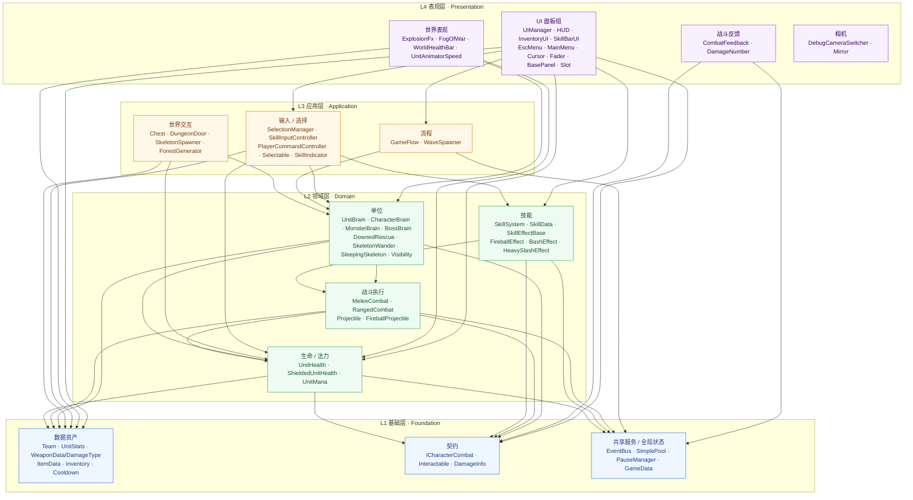
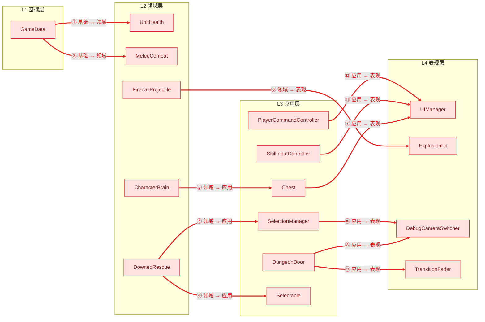
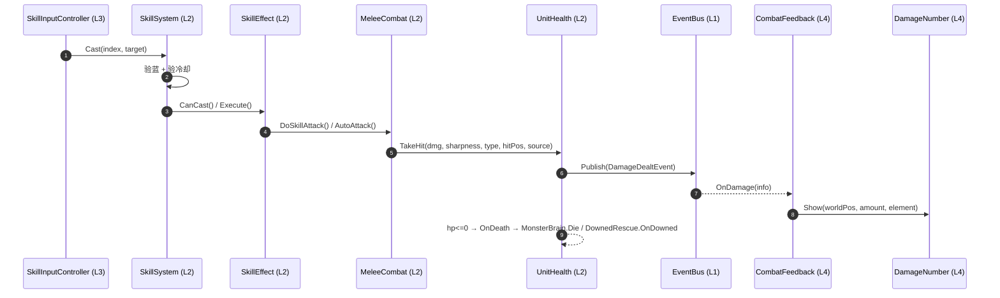

# PROPOSAL_FND-03 — 模块依赖地图与重构候选清单

> 状态：`Archived`（2026-11-05 所有者确认本单完成并归档；**本文件不授权任何代码/资产改动**）
> 类型：【分析产物】全项目静态依赖测绘 + 重构批素材 + 论文架构图素材
> 文件风险：低风险（纯文档）；各重构候选的内部风险单独标注
> 分析基线：`7cf874f7`（2026-11-05）＋ 工作区未提交的 SPEC-01-CLEANUP 改动（`SwordSwing` → `MeleeCombat` 等）
> 分析范围：`Assets/_Project/Scripts/` 全部 **63** 个 `.cs`；不含 `Assets/_Project/Tests/`、`StarterAssets/`、`TutorialInfo/`
> 分析方式：静态类型引用分析；**未运行 Unity、未运行构建、未运行测试**（口径与盲区见 §7）
> 用途：① 重构批计划书素材；② 学位论文架构图素材（mermaid 可直接渲染）

---

## 0. 结论摘要

四层骨架已经存在，但分层依赖尚未成立：**12 条反向依赖、4 组环，其中一组是 11 节点强连通块**。真正的风险不是"分层错了"，而是 `UIManager` / `GameData` / `SelectionManager` 三个全局单例把 UI、输入、领域焊在一起。

另有一处**比 12 条边更隐蔽的职责错位**：`ExplosionFx` 被归入表现层，却在爆发帧执行 `Physics.OverlapSphere` + `TakeHit` 的 AOE 伤害结算。这不是依赖方向问题，而是**职责归属问题**——即使切断 `FireballProjectile → ExplosionFx` 的类型引用（R5），爆炸伤害仍然留在 VFX 类里。因此本文件新增 **R5b** 单独处理。

重构批不应从最热的 `UnitHealth` 开刀，而应先拆 UI / 输入 / 领域这个 11 节点结；`UnitHealth` 与 `UIManager` 的攻坚（R14/R15）列为缓行，详见 §6.3。

---

## 1. 范围与口径校正

| 常见描述 | 实际仓库 | 本文件处理 |
|---|---|---|
| 约 47 个生产脚本 | `Assets/_Project/Scripts/` 下 **63 个** `.cs`（Combat 14 / Core 5 / Debug 2 / Framework 1 / Items 3 / Player 5 / System 6 / UI 10 / Units 17） | 按 63 个建图 |
| 根目录散落 `HUD.cs`、`SkillSystem.cs`、`GameData.cs` | `Assets/` 根目录**没有** `.cs`；三者分别在 `UI/`、`Units/`、`Core/` | 按实际路径 |
| — | `Assets/_Project/Scripts/Monster/` 是**空目录**，无脚本 | 不计入 |
| — | 全目录**零第三方命名空间**，只依赖 `UnityEngine` / `.AI` / `.UI` / `.EventSystems` / `.SceneManagement` + BCL | 论文可写"外部依赖面极窄" |

**基线差异提醒**：当前工作区存在未提交的 SPEC-01-CLEANUP 改动（`SwordSwing.cs` 删除、`MeleeCombat.cs` 新增、`SkillEffects.cs` / `GameData.cs` / `HUD.cs` / `SkillSystem.cs` 修改）。本文件的边以**工作区当前内容**为准；若回到 `7cf874f7` 纯提交状态，`MeleeCombat` 应读作 `SwordSwing`，其余边不变。

---

## 2. 分层模型（判据）

按**职责 + 允许的依赖方向**分层，而不是按文件夹名硬套：

| 层 | 名称 | 判据 | 允许依赖 |
|---|---|---|---|
| **L4** | 表现层 Presentation | 只回答"玩家看到什么"：UI 面板、飘字、VFX、相机、迷雾、血条 | → L3 / L2 / L1 |
| **L3** | 应用层 Application | 把输入/流程翻译成领域指令：选择、施法输入、关卡流程、世界交互 | → L2 / L1 |
| **L2** | 领域层 Domain | 玩法规则本体：单位 AI、生命/法力、战斗执行、技能、弹道 | → L1 |
| **L1** | 基础层 Foundation | 数据资产、枚举、契约接口、无状态服务、全局状态 | 只依赖引擎 / BCL |

**硬规则**：箭头只许从高层指向低层。L1 反过来引用 L2/L3/L4、L2 引用 L3/L4、L3 引用 L4，全部算违规，§4.2 标红。

两个刻意的归类，先说明理由：

- `PauseManager` 归 **L1**：它只碰 `Time.timeScale` 与 `IsPaused`，是跨切面服务，不承载玩法规则。若归 L3，会凭空制造 8 条假违规。
- `GameData` 归 **L1**：本质是全局会话状态容器。但它内部藏了 `TryLevelUp` 的玩法逻辑，所以它产生的 2 条反向边是真问题（见 R10）。

---

## 3. 分层表（63 行）

> 表中路径省略统一前缀 `Assets/_Project/Scripts/`。
> **入度** = 直接静态引用该脚本的**生产脚本数**（不含自身；同一脚本多次出现只算 1）。
> **依赖** = 该脚本引用的其他脚本（按类型归属到文件）。
> `*` = 该文件的入度被它顺带声明的枚举抬高，见 §5.1 脚注。

### 3.1 L4 表现层（18）

| 路径 | 层 | 职责（一句话） | 入度 | 依赖谁 |
|---|---|---|---|---|
| `UI/UIManager.cs` | L4 | UI 唯一咽喉：面板栈、Tab/I/C/Esc、独占面板 | 6 | GameFlow, Inventory, SelectionManager, Chest, BasePanel, EscMenuPanel, InventoryUI, MainMenuPanel |
| `UI/HUD.cs` | L4 | 金币/等级/击杀/消息文本 + U 键升级 | 0 | MeleeCombat, GameData, SelectionManager, UnitHealth |
| `UI/InventoryUI.cs` | L4 | 背包双网格视图（宝箱/玩家），纯视图 | 1 | GameData, Inventory, Chest, BasePanel, SlotClickHandler, Team, UnitHealth |
| `UI/EscMenuPanel.cs` | L4 | Esc 菜单：开关即暂停/恢复 | 1 | GameFlow, PauseManager, BasePanel, UIManager |
| `UI/MainMenuPanel.cs` | L4 | 开始界面：开关控制 timeScale 与 GameStarted | 1 | GameFlow, BasePanel, UIManager |
| `UI/SkillBarUI.cs` | L4 | 技能栏：图标/冷却遮罩/耗蓝/按键 | 0 | SelectionManager, SkillSystem |
| `UI/CursorManager.cs` | L4 | 上下文光标四态（默认/选择/攻击/交互）+ 染色缓存 | 0 | GameData, Selectable, SkillInputController, Interactable, UIManager, Team, UnitHealth |
| `UI/BasePanel.cs` | L4 | 面板生命周期基类：OnInit/OnOpen/OnClose | 4 | — |
| `UI/SlotClickHandler.cs` | L4 | 格子点击 → InventoryUI 回调 | 1 | — |
| `UI/TransitionFader.cs` | L4 | 黑屏淡入 → 回调 → 淡出 | 1 | — |
| `Combat/CombatFeedback.cs` | L4 | 订阅伤害事件，延迟 0.12s 弹飘字 | 0 | DamageInfo, DamageNumber, EventBus |
| `Combat/DamageNumber.cs` | L4 | 共享 Overlay 画布 + 32 容量池的飘字 | 1 | DamageInfo（仅 `DamageElement`） |
| `Combat/ExplosionFx.cs` | L4 | 两段式爆炸表现；**【待迁移】爆发帧 AOE 伤害结算**（当前属领域职责错位） | 1 | DamageType, Team, UnitHealth |
| `Debug/DebugCameraSwitcher.cs` | L4 | RTS 相机：旋转/平移/焦点跟随/震屏 | 2 | — |
| `Debug/Mirror.cs` | L4 | 镜面相机反射 | 0 | — |
| `System/FogOfWar.cs` | L4 | 网格战争迷雾，顶点色揭示 | 0 | Team, UnitHealth |
| `Units/WorldHealthBar.cs` | L4 | 头顶血蓝条：面向相机 + 可见性显隐 | 0 | Team, UnitHealth, UnitMana, Visibility |
| `Units/UnitAnimatorSpeed.cs` | L4 | 把 `UnitStats.attackSpeed` 写进 Animator 参数 | 0 | UnitBrain, UnitStats |

> **职责错位标注**：`ExplosionFx` 是 L4 中**唯一**直接造成领域结果（扣血/死亡）的脚本。它的 `DamageType/Team/UnitHealth` 三条依赖不是"读数据展示"，而是"写伤害状态"。这类错位不会在依赖方向上表现为红边（L4 → L2 本来就是合规方向），所以比 §4.2 的 12 条更隐蔽。处理方式见 **R5b**。

### 3.2 L3 应用层（11）

| 路径 | 层 | 职责 | 入度 | 依赖谁 |
|---|---|---|---|---|
| `Player/SelectionManager.cs` | L3 | 单选/加选/全选/点敌/点交互物，驱动相机焦点 | 8 | PauseManager, DebugCameraSwitcher, Selectable, SkillInputController, Interactable, CharacterBrain, Team, UnitHealth |
| `Player/SkillInputController.cs` | L3 | QWER 瞄准 / 快捷施法 / 越界追放 | 3 | PauseManager, SelectionManager, SkillIndicator, UIManager, CharacterBrain, SkillData, SkillSystem, Team, UnitHealth |
| `Player/PlayerCommandController.cs` | L3 | 右键移动指令 + 移动动画参数 | 0 | PauseManager, SelectionManager, SkillInputController, UIManager, CharacterBrain |
| `Player/Selectable.cs` | L3 | 可选中标记 / 选中圈 / 热键序号 | 3 | SelectionManager |
| `Player/SkillIndicator.cs` | L3 | 技能范围圈 + 指向线 | 1 | — |
| `Core/GameFlow.cs` | L3 | 开局判定 / 团灭冻结 / R 重开 | 3 | GameData, DownedRescue, Team, UnitHealth |
| `Core/WaveSpawner.cs` | L3 | 波次刷怪 + 每波血量递增 | 0 | GameData, UnitHealth |
| `System/Chest.cs` | L3 | 开盖动画 + 内容物入包 + 打开双面板 | 3 | GameData, ChestItem, Inventory, ItemData, UIManager, CharacterBrain |
| `System/DungeonDoor.cs` | L3 | F 键过场传送全队 + 切镜头 | 0 | GameData, DebugCameraSwitcher, SelectionManager, TransitionFader, Team, UnitHealth |
| `System/SkeletonSpawner.cs` | L3 | 随机分组刷骷髅并挂 Wander/Visibility | 0 | SkeletonWander, Visibility |
| `System/ForestGenerator.cs` | L3 | 森林边界/散布 + Collider + NavMeshObstacle | 0 | — |

### 3.3 L2 领域层（20）

| 路径 | 层 | 职责 | 入度 | 依赖谁 |
|---|---|---|---|---|
| `Units/UnitHealth.cs` | L2 | 统一生命 + 受击管线 + 伤害事件 + 复活 | **26** | DamageInfo, DamageType, EventBus, Team, UnitStats |
| `Units/UnitBrain.cs` | L2 | 大脑基类：导航 / 索敌 / 攻击循环 | 5 | ICharacterCombat, Team, UnitHealth, UnitStats |
| `Units/CharacterBrain.cs` | L2 | 玩家 Driver：指令移动/集火/坚守/交互执行 | 4 | DamageInfo, ICharacterCombat, PauseManager, Chest, Interactable, Team, UnitBrain, UnitHealth |
| `Units/MonsterBrain.cs` | L2 | 怪物 Driver：索敌/攻速/动画时钟命中窗/僵直 | 3 | ICharacterCombat, GameData, PauseManager, Team, UnitBrain, UnitHealth |
| `Units/BossBrain.cs` | L2 | Boss AI：平砍 / 蓄力 AOE / 半血召唤 / 死亡奖励 | 0 | DamageType, GameData, PauseManager, SleepingSkeleton, Team, UnitHealth, UnitStats |
| `Units/DownedRescue.cs` | L2 | 倒地 / 救援读条 / 受击打断 / 复活 | 1 | DamageInfo, GameData, PauseManager, Selectable, SelectionManager, UnitBrain, UnitHealth |
| `Units/SkeletonWander.cs` | L2 | 漫游态：随机游走，警觉/受击唤醒 MonsterBrain | 1 | MonsterBrain, Team, UnitHealth |
| `Units/SleepingSkeleton.cs` | L2 | 倒地末帧，`WakeUp()` 起身后启用 AI | 1 | MonsterBrain |
| `Units/Visibility.cs` | L2 | 视野/遮挡判定 → 隐藏模型血条并冻结 AI | 2 | Team, UnitBrain, UnitHealth |
| `Units/ShieldedUnitHealth.cs` | L2 | 正面扇形减伤的 UnitHealth 子类 | 0 | DamageType, UnitHealth |
| `Units/UnitMana.cs` | L2 | 法力上限 / 每秒回复 / 消耗 | 2 | — |
| `Units/SkillSystem.cs` | L2 | QWER 槽位 + 验蓝验冷却 + 效果链执行 | 5 | MeleeCombat, GameData, Cooldown, SkillData, UnitMana |
| `Units/SkillData.cs` | L2 | 技能 SO：耗蓝 / 冷却 / 效果链 | 2 | SkillEffectBase, Cooldown |
| `Combat/MeleeCombat.cs` | L2 | 近战执行器：动画时钟命中窗、单体/扫掠 | 3 | ICharacterCombat, WeaponData, GameData, Team, UnitHealth, UnitStats |
| `Combat/RangedCombat.cs` | L2 | 远程执行器：动画时钟放箭帧 | 0 | ICharacterCombat, Projectile, SimplePool, UnitHealth, UnitStats |
| `Combat/Projectile.cs` | L2 | 抛射物基类：追踪/抛物线/到达结算/池回收 | 2 | SimplePool, DamageType, UnitHealth |
| `Combat/FireballProjectile.cs` | L2 | 火球弹：到达时生成爆炸并注入伤害参数 | 1 | ExplosionFx, Projectile |
| `Combat/SkillEffectBase.cs` | L2 | 技能效果策略基类（以 `SkillSystem` 为施法者上下文） | 3 | SkillSystem |
| `Combat/SkillEffectFireball.cs` | L2 | 火球术效果资产：前摇 → 发射火球 | 0 | FireballProjectile, SimplePool, SkillEffectBase, GameData, SkillSystem, UnitHealth |
| `Combat/SkillEffects.cs` | L2 | 盾击（伤害/击退/僵直）+ 强化斩 | 0 | SkillEffectBase, DamageType, GameData, MonsterBrain, SkillSystem, UnitHealth |

### 3.4 L1 基础层（14）

| 路径 | 层 | 职责 | 入度 | 依赖谁 |
|---|---|---|---|---|
| `Units/Team.cs` | L1 | 阵营枚举（索敌/光标/仇恨的唯一分区依据） | **18** | — |
| `Core/GameData.cs` | L1 | 全局金币/等级/击杀/消息 + 升级逻辑 | **14** | MeleeCombat, UnitHealth |
| `Core/PauseManager.cs` | L1 | 全局 `timeScale` / `IsPaused` 服务 | **8** | — |
| `Combat/WeaponData.cs` | L1 | 武器 SO + `DamageType` / `GripType` 枚举 | 8* | — |
| `Units/UnitStats.cs` | L1 | 单位数值 SO（HP/伤害/射程/攻速/移速） | 6 | Team |
| `Combat/DamageInfo.cs` | L1 | 伤害数据包 + `DamageDealtEvent` / `UnitDiedEvent` + 元素枚举 | 5 | DamageType, UnitHealth |
| `Combat/ICharacterCombat.cs` | L1 | 战斗执行器契约：`AutoAttack` / `CancelAttack` | 5 | — |
| `Combat/SimplePool.cs` | L1 | 按预制体分池的极简对象池 | 3 | — |
| `Items/Inventory.cs` | L1 | 定容槽位背包 + `OnChanged` | 3 | ItemData |
| `Items/ItemData.cs` | L1 | 物品 SO | 3 | — |
| `Items/ChestItem.cs` | L1 | 宝箱展示模型上的物品声明 | 1 | ItemData |
| `System/Interactable.cs` | L1 | 可交互标记 + hint 文案 | 3 | — |
| `Core/EventBus.cs` | L1 | 静态泛型事件总线 | 2 | — |
| `Framework/Cooldown.cs` | L1 | 冷却计时结构（Ready/Remaining/Trigger） | 2 | — |

---

## 4. 依赖方向图

### 4.1 图 A · 分层投影（论文主图，只画合规方向）



**读图提示**：`CAM`（相机）在合规图中**没有入边**——它不是被同层或下层使用，而是只被 L3 反向调用（图 B 的 ⑧⑨⑩）。这是问题信号，不是遗漏。

### 4.2 图 B · 12 条反向依赖（重构批首批候选，全红）



**按性质归类：**

| 类型 | 条目 | 本质问题 |
|---|---|---|
| 基础层反向（2） | ①② | 全局状态容器 `GameData` 里塞了升级玩法，直接操作 `MeleeCombat` 和 `UnitHealth` |
| 领域→应用（3） | ③④⑤ | 领域对象反过来查全局选择/具体宝箱，导致 AI 无法独立测试 |
| 领域→表现（1） | ⑥ | 弹道类直接 `GetComponent<ExplosionFx>()`，逻辑认识 VFX |
| 应用→表现（6） | ⑦⑧⑨⑩⑪⑫ | 输入/流程类直接调 UI 单例与相机/过场组件 |

> **与职责错位的区别**：图 B 的 ⑥ 只说明"谁引用了谁"。即使把 ⑥ 切断，`ExplosionFx` 内部仍然在扣血——那是 R5b 要处理的另一层问题。

### 4.3 图 C · 核心运行时链路（论文"一次攻击"时序图）



这条链是全项目最健康的一段：伤害结算与表现通过 `EventBus` + `DamageInfo` 解耦，表现层只订阅、不反查逻辑。论文可把它作为"已落地的事件驱动范式"，再对照图 B 说明其余部分尚未采用同一范式。

---

## 5. 结构热点与环

### 5.1 被引用最多的 5 个脚本（枢纽）

| 排名 | 脚本 | 入度 | 性质 | 判读 |
|---|---|---|---|---|
| 1 | `Units/UnitHealth.cs` | **26** | 领域枢纽 | 全项目 41% 的脚本直接引用它。合理（统一伤害入口），但它同时承担 HP 状态、受击管线、受击闪白、事件发布四项职责 |
| 2 | `Units/Team.cs` | **18** | 纯枚举 | 零成本分区，**不算耦合**，是好的设计 |
| 3 | `Core/GameData.cs` | **14** | 全局可变静态 | 隐蔽耦合最大：任何层都能读写金币/等级/消息，且带 `OnChanged` 事件 |
| 4 | `Player/SelectionManager.cs` | **8** | 输入中枢单例 | 被 UI（HUD/SkillBar/UIManager）、领域（DownedRescue）、世界交互（DungeonDoor）同时读 |
| 5 | `Core/PauseManager.cs` | **8** | 全局服务单例 | 8 处直接 `PauseManager.instance.IsPaused` 早退，散落在 4 个目录 |

> **并列第 5**：`Combat/WeaponData.cs` 入度 8，但 7 条来自 `DamageType` 枚举，属"假枢纽"。
> **剔除纯枚举后的实质枢纽**：`UnitHealth` 26 → `GameData` 14 → `SelectionManager` 8 / `PauseManager` 8 → `UIManager` 6 / `UnitStats` 6。

**分布形状**：26 → 18 → 14 → 8 → 8 → 6 … 是典型的**长尾 + 单点巨型枢纽**曲线。论文含义：系统有一个绝对核心（生命/伤害），三个次级全局点（数据/选择/暂停），其余是长尾。可维护性尚可，但**单点故障半径大**。

### 5.2 扇出热点（谁最"贪"）

| 脚本 | 直接依赖数 | 说明 |
|---|---|---|
| `SkillInputController` | 9 | 同时抓选择、UI、相机、角色、技能、数据 |
| `CharacterBrain` | 8 | 抓了 Chest、Selection 相关的具体类型 |
| `SelectionManager` | 8 | 输入 + 相机 + 领域 + 交互物 |
| `UIManager` | 8 | 面板 + 流程 + 选择 + 宝箱 |
| `BossBrain` | 7 | 一个 AI 抓了 7 个类型，属正常上限 |
| `CursorManager` | 7 | 光标判定重复了 SelectionManager 的射线逻辑 |

### 5.3 环形依赖：存在，共 4 组

| # | 环 | 节点数 | 严重度 | 说明 |
|---|---|---|---|---|
| 1 | `UnitHealth ↔ DamageInfo` | 2 | 低 | 数据契约互指（`UnitHealth` 造 `DamageInfo`，`DamageInfo` 持有 `UnitHealth`）。同层、同程序集，**不建议拆**，拆了反而增加转换成本 |
| 2 | `GameData ↔ MeleeCombat` | 2 | 中 | `GameData.TryLevelUp` 改 `MeleeCombat.dmgMult`；`MeleeCombat.Start` 读 `GameData.level`。基础层与领域层互指 |
| 3 | `SkillData → SkillEffectBase → SkillSystem → SkillData` | 3 | 中 | 效果基类把 `SkillSystem` 写进抽象方法签名，而 `SkillSystem` 又持有 `SkillData` |
| 4 | **UI / 输入 / 领域大环** | **11** | **高** | `GameFlow`、`Chest`、`UIManager`、`SelectionManager`、`SkillInputController`、`Selectable`、`DownedRescue`、`CharacterBrain`、`EscMenuPanel`、`InventoryUI`、`MainMenuPanel` |

**大环里套着 6 组双向对**，这是它膨胀的原因：

```text
SelectionManager ↔ Selectable              （注册 / 回写选中圈）
SelectionManager ↔ SkillInputController    （读 Primary / 读 IsTargeting）
UIManager        ↔ EscMenuPanel            （开面板 / 关自己）
UIManager        ↔ MainMenuPanel
UIManager        ↔ Chest                   （ShowInventory / 反查）
CharacterBrain   ↔ Chest                   （OpenBy / GetComponent<Chest>）
```

再加 `UIManager → GameFlow → DownedRescue → SelectionManager → CharacterBrain → Chest → UIManager`，11 个节点被焊死。**这是重构批的第一优先级，不是 `UnitHealth`。**

---

## 6. 重构候选清单（低风险 → 高风险）

> 每条只写**动作 + 收益**。风险分级同时给出影响面。

### 6.1 低风险（纯整理 / 局部查询源替换，不改结算语义）

| # | 候选 | 收益（一句话） |
|---|---|---|
| R1 | 把 `DamageType`/`GripType` 从 `WeaponData.cs`、`DamageElement` 从 `DamageInfo.cs` 拆成独立枚举文件 | 消灭 `WeaponData.cs` 的 8 入度假枢纽，让论文的枢纽统计只反映真实耦合。 |
| R2 | 把 `UnitAnimatorSpeed` 从 `Units/` 迁到表现层目录（或改名 `UnitAnimatorSpeedView`） | 领域目录不再混入纯表现组件，目录与分层表一致，评审时不用解释例外。 |
| R3 | 给 `ExplosionFx`/`DamageNumber`/`CombatFeedback`/`FogOfWar` 建 `Presentation/` 子目录（可选再加 asmdef） | 把"表现层不得被领域引用"从口头约定变成目录/编译期约束。 |
| **R17** | **历史债复核转移（2026-10-31 审查 #3）**：原登记对象 `SkillInputController.NearestEnemy` 已于 `e78ebbae`（2026-10-31）当日以 0.25s 缓存闭合（`enemyCacheInterval` / `_cacheTimer` / `RefreshEnemyCache`），台账未销账，本次核销。真实每帧 `FindObjectsByType<UnitHealth>` 全场景扫描落在四处：`UnitBrain.FindNearestEnemy`、`BossBrain.FindNearestPlayer`、`Visibility.IsVisibleToAnyPlayer`、`GameFlow.Update`。改造按 `Docs/01` §4.2 引入楼层级 `UnitRegistry`（生成/启用注册、死亡/销毁注销、按队伍与范围查询），四处改为查注册表。**技术注记**：缓存失效不要用"定时全量重查"——单位死亡/新生会造成空引用或一拍延迟；订阅既有 `EventBus` 的 `UnitDiedEvent`（及生成点）做增量失效＋按需重建，与决策 #6 的事件驱动管线同范式（参见 `Docs/01` §4.3 事件规范）。 | 消除每帧全场景查询；顺带把"查找"职责从 `UnitHealth` 的 26 入度中迁到注册表，为 R15 减负。 |

> **R17 的风险边界**：只替换查询源（四处调用点改查注册表）时为低风险；若同一单里把生成/销毁注册也全面重构，则升级为中低风险并移入批 2。建议批 1 只做"注册表只读查询替换 + 最小注册接线"。

### 6.2 中低风险（单文件 + 1~3 个调用点）

| # | 候选 | 收益 |
|---|---|---|
| R4 | `CharacterBrain` 用 `IInteractable` 接口取代 `GetComponent<Chest>()` 特判 | 切断 ③ 和 `CharacterBrain ↔ Chest` 双向对，交互物可扩展而不改 AI。 |
| R5 | `FireballProjectile` 不直接依赖 `ExplosionFx`，改由效果资产注入 `IDamageArea` 或发事件 | 切断 ⑥，领域弹道不再认识任何 VFX 类，换爆炸表现不动弹道。 |
| **R5b** | **爆炸 VFX 与伤害结算分离**：`ExplosionFx` 只保留核心闪现/碎片/材质/自毁；把爆发帧的 `Physics.OverlapSphere` + `TakeHit` 结算移到效果资产或领域层（如 `ExplosionDamage` / `IDamageArea`，由 `FireballEffect` 驱动）。与 R5 配套但**独立成立**：R5 断的是类型引用，R5b 移的是职责 | 消除"表现层拥有伤害结算"的职责错位；`ExplosionFx` 可被纯视觉复用（陷阱、环境、UI 预览），伤害平衡只改一处，AOE 结算可单测。 |
| R6 | `DownedRescue` 不再读 `SelectionManager.instance`，改由 `CharacterBrain` 的救援指令驱动 | 切断 ④⑤ 两条领域→应用反向边，倒地/救援可脱离输入系统单测。 |
| R7 | `BashEffect` 对 `MonsterBrain` 的具体依赖改为 `IStaggerable` | 技能资产与具体怪物 AI 解耦，新增怪物类型不用改技能。 |
| R8 | `SkillEffectBase` 的 `SkillSystem` 参数抽成 `ISkillCaster`（施法者上下文） | 解开环 3，效果资产不再依赖具体 MonoBehaviour，可对施法者做假对象测试。 |

> **R5 与 R5b 的关系**：R5 是依赖方向修复，R5b 是职责归属修复。只做 R5，`ExplosionFx` 仍会在爆炸帧扣血；只做 R5b，`FireballProjectile` 仍要 `GetComponent<ExplosionFx>()` 来灌参数。两条可同一批做，但验收标准分开写：R5 看依赖图，R5b 看"VFX 类是否还持有 `UnitHealth` 结算调用"。

### 6.3 中风险（跨 3~8 个文件，需回归验证）

| # | 候选 | 收益 |
|---|---|---|
| R9 | `Chest` 打开 UI 改为 `ChestOpenedEvent` + `UIManager` 订阅 | 切断 ⑦ 与 `Chest ↔ UIManager` 环，宝箱可脱离 UI 单测，也为"多种容器"留口。 |
| R10 | `GameData.TryLevelUp` 移到 `LevelUpService`，`GameData` 退化为纯数据容器 | 切断 ①② 与 `GameData ↔ MeleeCombat` 环，全局状态不再承载玩法规则。 |
| R11 | `DungeonDoor` 的相机/过场调用改为 `ICameraFocus` / `IFader` 接口或事件 | 切断 ⑧⑨，传送流程可脱离具体相机与 CanvasGroup 测试。 |
| R12 | `SelectionManager ↔ SkillInputController` 的静态单例互指改为"输入仲裁器 + 只读查询接口" | 解开 L3 内部 2 节点环，选择/瞄准/追放三种输入模式可独立验证。 |
| R13 | `PauseManager` 由 8 处直接单例访问改为注入的 `ITimeService`（或至少只读静态属性 + 事件） | 暂停语义集中一处，所有玩法类可脱离单例构造测试。 |

### 6.4 高风险（核心管线 / 公共契约 / 全项目影响）

| # | 候选 | 收益 |
|---|---|---|
| R14 | `UIManager` 去单例：改为事件总线 + 面板接口，并拆成"面板栈 / 暂停 / 输入门禁"三职责 | 拆掉 11 节点大环的 UI 侧一半（⑦⑪⑫），是全项目耦合的最大单点。 |
| R15 | 拆分 `UnitHealth`：HP 状态 / 伤害管线 / 受击闪白表现 / 事件发布 | 26 引用的枢纽瘦身，伤害管线可单测；但触及全项目唯一伤害入口，必须 N≥3 回归。 |
| R16 | 把 11 节点大环作为**批次验收指标**分段治理（不是单工单） | 用 SCC 从 11 降到 ≤3 作为重构批的量化出口，论文可画前后对比图。 |

### 6.5 批次切法

| 批次 | 内容 | 目标 | 启动条件 |
|---|---|---|---|
| 批 1 | R1–R3、R17 | 零行为变化（R1–R3）＋ 查询源替换（R17，以 `UnitRegistry` 替换四处每帧扫描，不改伤害/死亡结算语义） | 立即可评估 |
| 批 2 | R4–R5b、R6–R8 | 领域层"去具体类型 + 去职责错位"，领域→应用/表现反向边清零 | 批 1 完成 |
| 批 3 | R9–R13 | 切断 7 条应用/基础反向边，解开 3 个小环 | 批 2 完成且回归稳定 |
| 批 4 | R14–R15，R16 作为验收指标 | 攻坚 UI 单例与 UnitHealth，SCC 从 11 降到 ≤3 | **缓行，见下方注记** |

> **缓行注记（批 4）**：批 4（R14 / R15）**不在首批启动范围**。必须在批 1–3 全部完成、回归稳定（连续 N≥3 次通过、无新增红、外部复核通过）之后，由所有者视剩余预算与风险承受度**另行决定**是否启动；未获单独批准不得开工。R16 只作为批 4 的量化验收指标，不单独派工单。

> **关于 R5b 的批次归属**：R5b 放在批 2 而不是批 1，原因是它要动爆炸预制体上的 `damageRadius / damage / sharpness / source` 序列化字段与 `FireballEffect` 的装配关系，属于"行为等价性需要验证"的改动；若只想先降风险，可把 R5b 拆成"先加 `IDamageArea` 抽象、暂不迁行为"的准备步，再在批 3 完成迁移。

---

## 7. 不确定性声明（请连同地图一起引用）

> **本次分析没有运行 Unity，也没有运行任何构建、测试或 Play Mode。** 所有依赖边来自静态源码：类型声明、`using`、字段/参数/返回值类型、泛型实参、`GetComponent<T>` / `AddComponent<T>` / `FindObjectOfType<T>`、`typeof`。分析时已剔除 `//` 与 `/* */` 注释，并手工修正 1 处误报（`DamageNumber` 里的 `CanvasGroup.interactable` 被正则误判为 `Interactable` 类型）。因此：

1. **入度 0 的脚本不是孤儿**。它们多数是场景/预制体入口（`HUD`、`CursorManager`、`WaveSpawner`、`BossBrain`、`SkeletonSpawner`、`ForestGenerator`、`FogOfWar`、`Mirror`、`WorldHealthBar`、`UnitAnimatorSpeed`、`CombatFeedback`）或由资产配置驱动（`BashEffect`、`HeavySlashEffect`、`FireballEffect`、`ShieldedUnitHealth`、`RangedCombat`）。
2. **未覆盖的依赖通道**：
   - **Inspector 拖线**：`BossBrain.sleepingMinions/rewardChest`、`SkillSystem.skills`、`SkillData.effects`、`SkeletonSpawner.skeletonPrefabs`、`WorldHealthBar.health/mana/hpFill`、`Chest.lid`、`DungeonDoor.dungeonEntryPoint/cameraPoint`、`MeleeCombat.weapon` 等。
   - **UnityEvent 字符串绑定**：`EscMenuPanel.OnClickResume/Restart`、`MainMenuPanel.OnClickStart`（场景 YAML 里按方法名挂接）。
   - **Animator Event**：`RangedCombat.OnReleaseEvent()`。
   - **ScriptableObject 资产引用**：`UnitStats`、`WeaponData`、`ItemData`、`SkillData → SkillEffectBase[]`。
3. **字符串约定耦合**（静态图完全看不见，但改名字就会炸）：
   - Animator 参数/状态名：`AttackMelee`、`Attack_Draw`、`Attack_Release`、`Skill`、`Interrupt`、`Hit`、`Die`、`Speed`、`AttackSpeed`、`Grounded`、`Skeletons_Rise/Death`；
   - Layer 名：`Obstacle`、`Tree`、`PlayerBody`；
   - 路径查找：`GameObject.Find("DamageNumberOverlay")`、`transform.Find("EnemyRing")`；
   - Shader：`Shader.Find("Universal Render Pipeline/Unlit")` / `"Lit"`；
   - 场景：`SceneManager.GetActiveScene().buildIndex`。
4. **反射**：全目录未发现 `System.Reflection` / `GetType()` 驱动的动态查找，此项可排除。
5. **基线差异**：本图基于 `7cf874f7` + 工作区未提交的 SPEC-01-CLEANUP 改动；若只看 `7cf874f7` 纯提交，`MeleeCombat` 应读作 `SwordSwing`。

**结论强度分级**

| 结论 | 强度 | 原因 |
|---|---|---|
| 分层归属与 12 条反向边 | 高 | 类型级硬引用，注释已剔除 |
| 4 组环 / SCC | 高 | 由硬引用计算，不受 Inspector 影响 |
| "谁在运行时真正调用谁" | 中 | 受 Inspector 拖线、UnityEvent、Animator Event 影响 |
| 入度为 0 的脚本"无依赖" | 低 | 仅代表无静态类型引用，不代表无场景/资产绑定 |

---

## 8. 附：本文件的自我边界

- 本文件是**分析产物**，不是 TASK，不授权修改任何 `.cs`、场景、预制体、Animator、ProjectSettings 或 `.meta`。
- 文中的 mermaid 图可直接复制到支持 mermaid 的 Markdown 渲染器；图 A 为论文主图，图 B 为诊断图，图 C 为运行时链路图。
- 若后续重构落地，建议以本文件 §5.3 的 SCC 数量和 §4.2 的反向边数量作为**前后对比指标**，而不是以"代码是否更漂亮"作为验收口径。

---

## 9. 归档记录

| 项 | 内容 |
|---|---|
| 归档日期 | 2026-11-05 |
| 归档结论 | 本单完成。地图与 R1–R17 候选清单保留，作为重构批计划书与论文架构图素材；**不单独派单**。 |
| 补登记录 | 2026-11-05 所有者授权补登 **R17（历史债复核转移）**；原登记对象经核对已由 `e78ebbae` 闭合，本次核销并把候选转到四处真实每帧扫描。文件保持 `Archived`。 |
| 未启动项 | ① 图 A 的 SVG/PNG 导出——所有者确认暂不需要；② 批 1 正式 TASK 起草——暂不启动。 |
| 批 1 启动闸门 | 等 `SPEC-01-CLEANUP-2` 与 `FND-02B` 收口后，由所有者从本文件 §6.1 / §6.2 取候选再排期；本文件不预设批次日期。 |
| 复用时锚点 | 候选：§6.1（R1–R3、R17）、§6.2（R4–R5b、R6–R8）；验收指标：§4.2 反向边数量、§5.3 SCC 数量、R17 的 `FindObjectsByType` 逐帧调用点数。 |
| 维护约定 | 本文件归档后不再更新；若重构落地需要修订，由所有者重新开单，另建文档或在 TASK 中引用本文件。 |
