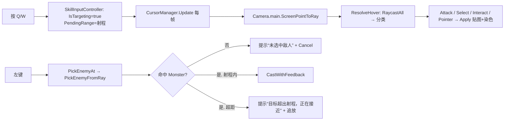

# SKILL-ANIM-01 讲稿：瞄准态的攻击指针与点击反馈

> **AI 出初稿，所有者需用自己的话改写。改不动的地方就是没懂 —— 让 AI 再讲一遍。**
> 套用方式：替换全部占位，删掉本 feature 用不上的小节；目标 1–2 页，能口头复述为准。

## 1. 一句话

瞄准技能时指针会告诉你能不能打到人；点下去没放出来，也会告诉你为什么。

## 2. 原来的问题 / 为什么需要

- 改之前的现象：按 Q/W 进入瞄准后，`CursorManager.Update` 第一件事就是判断 `SkillInputController.IsTargeting`，为真就 `SetHover(Hover.Pointer)` + `Apply(pointerCursor…)` 然后 `return`。整段 hover 分类（`RaycastAll` → 攻击/选择/交互）根本没跑。
- 不解决会怎样：玩家进入瞄准后指针恒定是普通箭头，移到敌人身上也不变；而点击又确实能选中敌人，于是“指针说不能打、实际能打”，指针等于骗人。再加上点空地/超距/施放失败全静默，测试时只能猜为什么没放出来。
- 触发条件：任何带目标的技能（当前 Q 的 `Bash`、W 的 `HeavySlash`），只要 `quickCast=false` 走瞄准流程就会遇到。

**为什么“瞄准就强制普通指针”是错的**：这条早退把“当前输入状态”当成了“光标状态”的替代品。瞄准态真正影响的是“点了会怎样”（施放而不是移动/选择），而不是“指向谁”。指针要回答的仍然是“鼠标下是什么”，所以分类逻辑该照跑，只是左键的后果不同。早退还把分类逻辑和瞄准状态耦合在一起，导致分类结果无法被单独测试。

## 3. 方案对比

| 方案 | 做法 | 为什么不选 / 为什么选 |
|---|---|---|
| A | `CursorManager` 删掉瞄准早退，抽纯函数 `ResolveHover(Ray)` | **选定**：光标逻辑仍集中一处，四态语义与灰度染色不变；纯函数可用合成射线在 batchmode 断言 |
| B | `SkillInputController` 里直接 `Cursor.SetCursor` | 不行：输入层耦合 UI 贴图/热点/染色，等于复制一份 `CursorManager`，且不可测 |
| C | 新建 `TargetingCursor` 组件 | 不行：隔离是隔离了，但 hover 逻辑变成两份，后续改规则必漏一处 |

## 4. 数据流

文字版：`输入（Q/W/左键）→ SkillInputController → SkillSystem.Cast`；`输入（鼠标位置）→ CursorManager.ResolveHover → Cursor.SetCursor`；`提示 → GameData.message`。

## 5. 关键代码 3–5 处

| 位置 | 这段在干嘛 |
|---|---|
| `Assets/_Project/Scripts/UI/CursorManager.cs:52` | 删掉瞄准态早退的位置；注释说明“瞄准态与常态共用同一套分类” |
| `Assets/_Project/Scripts/UI/CursorManager.cs:107` | `ResolveHover` 核心：`RaycastAll(ray, 300f, clickableLayers)` → 找 `Selectable` / 存活 Monster / `Interactable`，按 交互 > 选择 > 攻击 > 普通 的顺序返回 |
| `Assets/_Project/Scripts/Player/SkillInputController.cs:96` | 左键改用 `PickEnemyAt(Input.mousePosition)`，未命中先 `SetMessage("未选中敌人")` 再 `Cancel()` |
| `Assets/_Project/Scripts/Player/SkillInputController.cs:113` | 超距分支：`SetMessage("目标超出射程，正在接近")` 后进入追放（沿用原 `_chase` 流程） |
| `Assets/_Project/Scripts/Player/SkillInputController.cs:169` | `CastWithFeedback`：记录 `GameData.message` → `Cast`；false 且消息没变才补“技能释放失败”，不覆盖“冷却中/蓝量不足” |

## 6. 为什么这样写（设计取舍）

- **为什么不在 `SkillInputController` 里直接设光标**：光标是“全局呈现”，由四态（默认/选择/攻击/交互）、灰度染色、热点、交互 hint 组成，已经被 `CursorManager` 统一管理。输入层只知道“我在瞄准”，不知道“鼠标下是敌人还是宝箱”。直接 `Cursor.SetCursor` 会让状态判断散落两处，日后新增可交互物就会漏。
- **为什么抽 `ResolveHover` 三层重载**：`ResolveHover(Ray)` 给“只要分类”的调用方；`ResolveHover(Ray, out enemy, out distance)` 给需要“打到谁、多远”的测试与后续 UI；内部 5-out 版本保留 `Interactable`/`Selectable` 引用，供 `Update` 取 `inter.hint`。这样 `Update` 不再自己拼分类逻辑。
- **为什么提示用 `GameData.SetMessage`**：项目已有单行消息通道（`GameData.message` + `OnChanged`），不新建 UI，也不新增静态状态。
- **与架构不变量的关系**：没有新增全局单例，没有把数据塞进静态类；`CursorManager` 仍是唯一光标出口，符合“新增内容优先数据+组合”。

## 7. 边界 / 失败模式

- **相机为空**：`CursorManager.Update` 里先取 `Camera.main`，为空直接 `return`（改之前会每帧 NRE 刷屏）；断言侧 `Camera.main == null` 记 `InfraFailure`，不伪造通过。
- **敌人死亡**：`ResolveHover` 和 `PickEnemyFromRay` 都要求 `!uh.dead`，死亡瞬间指针回落到普通/选择；追放中目标死亡仍由 `Cancel()` 收口。
- **UI 遮挡**：背包打开时在 `Update` 最前面早退成普通指针（原有行为，本次未改）；其余 UI 面板不参与物理射线，所以“点到 UI 上却选中了背后敌人”属既有语义，本次没有引入新的遮挡判断。
- **`Cast` 静默失败**：`SkillSystem.Cast` 只在冷却/蓝量分支写消息，`CanCast` 失败是完全静默的；`CastWithFeedback` 用“消息是否变化”区分这两种情况，避免覆盖更具体的提示。
- **已知未覆盖**：瞄准态的 `PendingRange` 在 batchmode 下取不到（没有键盘输入，`IsTargeting` 无法稳定保持），只能靠追放目检确认。

## 8. 答辩 Q&A 5 条

1. **为什么不用另一种做法？** 直接在输入层设光标会把四态/染色/hint 复制一份，且 batchmode 无法断言；抽纯函数是最小改动且可测。
2. **影响哪些已有系统？** 只有光标呈现与技能输入两条链；`SkillSystem`、伤害管线、动画机都没动，SPEC01 既有 10 条全绿。
3. **新增一个技能 / 敌人要改哪里？** 技能仍然是“新建效果资产 + 填 `SkillSystem.skills`”，指针与点击不需要改；新敌人只要 `UnitHealth.team=Monster` 就自动获得攻击指针与可点选。
4. **怎么证明它是对的？** 红阶段（产品未改）`pass=10 fail=2`，绿阶段连续 3 次 `12/12`、`exit=0`；两条新断言用合成射线（相机→敌人胸口）验证分类与选敌，证据在 `Docs/QA/Evidence/SKILL-ANIM-01/`。
5. **如果重做一次会怎么改？** 一开始就把 hover 分类抽成纯函数，并给 `PendingRange` 留一个可注入的测试入口，让瞄准态本身也能进自动化。

## 9. 名词表

| 名词 | 含义 |
|---|---|
| hover 分类 | 一条射线命中什么 → 该显示哪种光标（`Hover` 枚举） |
| 合成射线 | 测试里直接用 `new Ray(相机位置, 指向敌人胸口)` 构造的射线，绕过 `WorldToScreenPoint` |
| 追放 | 目标超距时先走过去，进入射程自动释放 |
| `PendingRange` | 当前待放技能的射程，瞄准/追放期间有效，取消后归零 |
